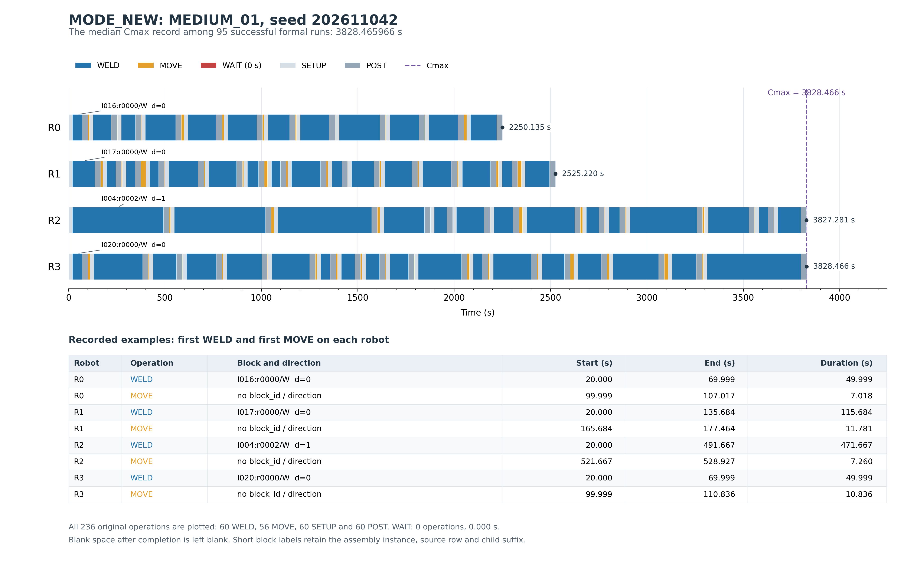

# 4 实验结果与分析

## 4.1 实验环境与参数设置

本研究面向船舶小组立焊接任务，采用20 m×12 m平台上的双滑轨四机器人任务模型，上轨包含R0和R1，下轨包含R2和R3。输入焊缝抽象为具有起止点和长度的线段。原始线段作为父焊缝，根据合法模式目录保留为整段任务，或拆分为两个子焊缝任务。WHOLE表示整段执行，Y_SPLIT表示沿Y覆盖规则形成的拆分，X_SPLIT表示指定轨内有限交接位置处的拆分。无法满足整段任务资格的父焊缝需要采用合法强制拆分；其他父焊缝只能在目录允许的模式和切点之间调整。

本章统一采用最短子焊缝长度0.50 m、X/Y拆分窗口0.50 m及FORMAL_SCOPE_V2。拆分窗口与最短子段长度分别约束候选切点和子段尺寸，不可相互替代。所有方法使用相同输入几何、合法模式目录、机器人任务资格、任务层区域与干涉约束，以及既有B32调度器。B32返回的FEASIBLE仅表示在上述抽象任务模型及既有调度规则下获得可调度方案。本研究不包含实际机器人URDF逆运动学可达性分析，也未开展实体或全臂碰撞检测，因此不作实际机器人可达性或物理无碰撞验证的主张。

对于长度为 $L_b$ 的子焊缝 $b$，其加工时间定义为

$$
p_b=t_{\mathrm{pre}}+\frac{L_b}{v_{\mathrm{w}}}+t_{\mathrm{post}},
$$

其中，$v_{\mathrm{w}}=0.0108\ \mathrm{m/s}$，$t_{\mathrm{pre}}=20\ \mathrm{s}$，$t_{\mathrm{post}}=30\ \mathrm{s}$。准备时间和后处理时间均按子焊缝计入，是有意设置的工艺参数，用于体现拆分增加任务数量时的附加工艺代价。本文所称加工负载 $P_r=\sum_{b\in\pi_r}p_b$ 包含准备、纯焊接和后处理，不等于纯WELD操作时间。

相邻任务的空走时间由其定向端点间的距离确定。若 $e_b(d_b)$ 为任务 $b$ 在方向 $d_b$ 下的出口，$s_c(d_c)$ 为后继任务 $c$ 的入口，则

$$
m_{bc}=\frac{\|e_b(d_b)-s_c(d_c)\|}{v_{\mathrm{e}}},\qquad
v_{\mathrm{e}}=0.20\ \mathrm{m/s}.
$$

方向0表示按子段保存的起点至终点执行，方向1表示反向执行。顺序和方向共同决定空走弧，方向已嵌入任务插入和路线重构，不存在独立方向优化阶段。MOVE与WAIT分别由已记录的空走、协调等待操作统计，等待时间不由加工负载差值估算。优化目标为

$$
\min C_{\max},\qquad C_{\max}=\max_{r\in\{0,1,2,3\}}C_r,
$$

其中 $C_r$ 为B32时间线中机器人 $r$ 的完成时间。所有Cmax均直接取自原始B32结果，而非负载或空走代理值。

**表4-1 实验模型与运行参数**

|参数|设置|
|---|---|
|平台尺寸|20 m×12 m|
|机器人配置|上轨R0/R1，下轨R2/R3|
|最短子焊缝长度|0.50 m|
|X/Y拆分窗口|$\delta_x=\delta_y=0.50\ \mathrm{m}$|
|轨间任务覆盖带|$B_y=[5.5,6.5]\ \mathrm{m}$|
|任务模式|WHOLE、Y_SPLIT、X_SPLIT|
|焊接速度|0.0108 m/s|
|空走速度|0.20 m/s|
|每个子焊缝的准备时间|20 s|
|每个子焊缝的后处理时间|30 s|
|任务层干涉参数|interference_dx=interference_dy=0.50 m|
|科学范围与调度器|FORMAL_SCOPE_V2，既有B32|
|优化目标|最小化Cmax|
|正式评价预算|60 s，包含初始化|
|开发消融预算|30 s，包含初始化|
|主方法与对应消融|MODE_NEW、FIXED_NEW|

实验采用项目既有Python实现。现有资料未完整保存正式运行时的硬件规格和软件版本，相关信息见表4-2，需在论文定稿前补充。不能将当前机器的环境查询结果直接替代正式实验运行时的环境记录。

**表4-2 待补充的实验计算环境信息**

|信息项|当前状态|
|---|---|
|CPU型号、主频、物理核心与线程数量|待补充正式运行时记录|
|主存容量|待补充|
|GPU是否参与计算及型号|待确认；不预设使用或未使用GPU|
|操作系统名称与版本|待补充|
|Python及关键依赖库版本|待补充|
|B32实现版本或正式实验代码修订号|待补充；不编造求解器版本|
|正式运行的并行进程数与线程设置|待作者确认；历史命令示例不代替完整运行环境说明|

## 4.2 实验实例与对比算法

正式实验使用20个独立几何，静态分为SMALL、MEDIUM、LARGE和HIGH_WORKLOAD四组，每组5个实例。实例由项目既有焊缝几何生成流程获得，形成于主方法选择和参数确定之后，未用于此前的算法开发与参数选择。HIGH_WORKLOAD依据总焊缝长度等静态几何和任务属性选取，不依据任何算法的Cmax筛选。各组实际父焊缝数量见表4-3；组名表示生成与分组目标，不表示每个实例均有相同的精确焊缝数量。

**表4-3 正式实例分组与运行规模**

|实例组|几何数量|实际父焊缝数量|每种方法运行次数|五种方法合计运行次数|
|---|---:|---|---:|---:|
|SMALL|5|均为35条|25|125|
|MEDIUM|5|54–57条|25|125|
|LARGE|5|63–85条|25|125|
|HIGH_WORKLOAD|5|65–92条|25|125|
|合计|20|保留各实例自然生成数量|100|500|

每个几何采用五个求解随机种子202611041、202611042、202611043、202611044和202611045。五种方法分别在每个几何和种子上运行，因此每种方法包含100次运行，总计500次正式运行。几何生成种子与求解随机种子是不同概念，不能混用。独立集已用于本次正式评价，未再根据其结果调整算法参数。

对比方法如下。

1. **MODE_NEW。** 采用共同规则初始化，以调度反馈驱动父焊缝选择，移除所选父的全部子段，在合法目录中提出父模式调整，再联合决定子段归属、插入位置和方向，最后由B32评价。只有截止前取得FEASIBLE且严格改善Cmax的方案才被接受。父选择实际包含RANDOM、TRAVEL和LOAD轮换，不能将其描述为每轮都确定性选择同一瓶颈机器人。
2. **FIXED_NEW。** 与MODE_NEW共享同一几何和种子下的共同初解、初始方向及初始化计时，保留相同的主要父选择、联合插入、B32评价和接受流程，但不允许父模式或切点改变。任务归属、路线顺序和方向仍可在联合修复中调整。因此，“固定模式”不等于固定路线或固定方向。
3. **WAG。** 采用项目现有适配WAG任务分配构造与变邻域搜索实现，在相同合法模式域及B32下进行评价。
4. **HGA。** 采用现有适配混合遗传算法，将种群进化与已有邻域改进相结合。
5. **REGION_FAST_ROUTE_REORDER。** 使用既有区域协同构造、加速搜索和路线重排配置。后文简写为REGION。该方法在本次0.50 m约束下实际运行，未引用历史0.20 m实验分数。

共同初解在MODE_NEW与FIXED_NEW之间保持一致；WAG、HGA和REGION保留各自已有的初始化结构。各方法统一的是任务模型、约束、B32与评价预算，不能将其误写为五种方法均使用相同初始化。本文不将遗传、VNS、LNS或Regret-2等通用思想作为原创贡献，比较重点是父模式调整、父级原子重构以及分配、排序和方向联合决策在当前焊接问题中的作用。

除正式实验外，已有两类研究记录用于方法选择。第一类为9个开发几何、3个种子、6种方法、30 s预算的162次开发运行，包含完整2×2消融及WAG、HGA对照。第二类为9个几何、3个种子、5种初始构造方法的135条GNN初始构造结果，其中Greedy复用Multi4的首个候选，不能视为135次彼此独立的候选采样。该阶段RULE/BEAM可行27/27，GNN-V2-Multi4为0/27，GNN-Shared-Multi4为6/27，既有GNN初始构造因此停止。该结论针对冻结既有模型在0.50 m合法目录中的表现，不表示重新训练了0.50 m域模型，也不等于对所有GNN方法的普遍结论。

上述开发记录、GNN初始构造记录与500次独立正式运行分别统计，不合并样本量。项目既有555项回归测试属于软件验证，不属于本章科学实验样本。

## 4.3 不同算法的总体性能比较

本章沿用既有最终报告的统计口径。可行次数和可行率使用每种方法全部100次正式运行。Cmax均值和中位数仅对成功运行计算，失败结果保持空值，不填0或人为惩罚值。平均运行时间则包含全部运行，包括初始化失败的提前返回。

**表4-4 五种方法的总体正式结果**

|方法|可行次数|可行率/%|成功运行平均Cmax/s|成功运行中位Cmax/s|平均运行时间/s|
|---|---:|---:|---:|---:|---:|
|MODE_NEW|95/100|95.0|3588.925|3828.466|58.947|
|FIXED_NEW|95/100|95.0|3615.081|3864.564|58.777|
|WAG|100/100|100.0|3782.582|3951.994|60.701|
|HGA|100/100|100.0|3913.853|3953.539|60.599|
|REGION|100/100|100.0|3862.769|3967.361|61.147|

表4-4中MODE_NEW与FIXED_NEW均有5次失败，三个强对照均成功100次。全部500次运行中490次取得可行方案，另10次失败保留在原始数据中。由于各方法的成功样本组成不同，不能仅根据MODE_NEW较低的成功Cmax均值判断其整体优于其他算法。

为控制不同几何的工作量差异，配对比较以几何而非单个随机种子为单位。对于几何 $g$ 和方法 $a$，先计算五个种子的Cmax算术平均：

$$
\bar C_{g,a}=\frac{1}{5}\sum_{s=1}^{5}C_{g,s,a}.
$$

仅当双方在该几何的五个种子均成功时，才计算相对对照方法 $b$ 的改善率：

$$
\Delta_{g,b}=100\%\times
\frac{\bar C_{g,b}-\bar C_{g,\mathrm{MODE\_NEW}}}{\bar C_{g,b}}.
$$

正值表示MODE_NEW的Cmax较低。胜、平、负及改善率均在完整配对几何上统计，沿用原报告的 $10^{-8}$ 个百分点比较容差。平均改善率是几何改善率的算术平均，中位改善率为这些几何改善率的中位数，均不通过混合所有种子和不同几何的Cmax重新定义。四项正式比较均排除HIGH_WORKLOAD_04，得到19个完整配对几何；五个种子不被当作五个独立几何。

**表4-5 MODE_NEW与各对照方法的几何配对结果**

|MODE_NEW相对方法|完整配对几何数|胜/平/负|平均改善率/%|中位改善率/%|
|---|---:|---:|---:|---:|
|FIXED_NEW|19|17/0/2|+0.6304|+0.3422|
|WAG|19|9/0/10|+2.5878|-0.1280|
|HGA|19|19/0/0|+5.6042|+2.3980|
|REGION|19|7/0/12|+1.6577|-0.3354|

MODE_NEW相对FIXED_NEW在19个几何中取得17胜2负，平均和中位改善率均为正，表明允许父模式调整在当前配置下具有增量价值。相对HGA，MODE_NEW在19个完整配对几何上均取得更低Cmax，平均改善5.6042%、中位改善2.3980%。然而，MODE_NEW的整体可行率为95%，低于HGA的100%，因此该结果仅支持完整配对条件下较好的Cmax表现，不能解释为整体支配HGA。

相对WAG，MODE_NEW为9胜10负，中位改善率为−0.1280%；相对REGION为7胜12负，中位改善率为−0.3354%。两项比较的平均改善率分别为+2.5878%和+1.6577%，但正向均值与负向中位数、较多负例同时存在，说明改善幅度在几何间分布不均衡。均值为正不能替代多数几何的胜负结果，也不足以证明MODE_NEW稳定优于WAG或REGION。

表4-6进一步列出相对WAG和REGION的分组配对结果，保持与总体相同的几何统计单位及改善率定义。

**表4-6 相对WAG与REGION的分组几何配对**

|实例组|对照方法|完整配对几何数|胜/平/负|平均改善率/%|中位改善率/%|
|---|---|---:|---:|---:|---:|
|SMALL|WAG|5|4/0/1|0.7124|0.6904|
|SMALL|REGION|5|2/0/3|5.7989|-0.2397|
|MEDIUM|WAG|5|2/0/3|0.0300|-0.1280|
|MEDIUM|REGION|5|3/0/2|-0.3585|0.0739|
|LARGE|WAG|5|1/0/4|6.1591|-0.3213|
|LARGE|REGION|5|1/0/4|0.9781|-2.5120|
|HIGH_WORKLOAD|WAG|4|2/0/2|3.6653|0.7029|
|HIGH_WORKLOAD|REGION|4|1/0/3|-0.1492|-0.9029|

SMALL组中，MODE_NEW相对WAG为4胜1负，中位改善0.6904%；MEDIUM与LARGE组的中位改善分别为−0.1280%和−0.3213%，未呈现一致优势。相对REGION，LARGE组为1胜4负，中位改善−2.5120%。HIGH_WORKLOAD仅有4个完整配对几何：MODE_NEW相对WAG为2胜2负，另一个几何存在五个种子的初始化失败。因此，该组成功配对的中位改善+0.7029%不能外推为整个高工作量组更优；相对REGION的1胜3负及中位−0.9029%也表明其局限。

平均运行时间还受到提前失败和返回时刻的影响。MODE_NEW的58.947 s与FIXED_NEW的58.777 s均包含五次未用完预算的初始化失败，不能将较短均值解释为更快收敛。60 s表示可接纳最佳解的评价截止，并不保证程序恰在60.000 s返回。既有实现允许已启动计算跨时返回，但跨截止完成的候选不更新最佳解，因此对照方法平均返回时间略高于60 s并不表示其较晚结果被计入Cmax比较。

## 4.4 父焊缝模式调整消融实验

消融比较仅改变是否允许父模式及切点调整。MODE_NEW和FIXED_NEW采用同一共同初解和方向，并在相同预算及主要搜索流程下运行。开发集包含9个几何、每个3个种子、30 s预算；完整162次矩阵还包含其余两种联合修复变体和两个基线，MODE_NEW与FIXED_NEW各占27次，不能将162次全部视为两方法消融样本。独立正式集则为每方法100次60 s运行，其中19个几何满足完整配对要求。

**表4-7 父模式调整在开发集与独立正式集上的效果**

|数据集与预算|MODE_NEW可行/总次数|FIXED_NEW可行/总次数|完整配对几何数|胜/平/负|平均改善率/%|中位改善率/%|
|---|---:|---:|---:|---:|---:|---:|
|开发消融，30 s|27/27|27/27|9|5/1/3|+2.15937|+0.51696|
|独立正式，60 s|95/100|95/100|19|17/0/2|+0.6304|+0.3422|

开发集与独立集均得到正向的平均和中位改善，但独立集平均改善降至0.6304%、中位改善为0.3422%，表明收益幅度有限。独立集中17个几何改善、2个退化，支持允许模式调整在当前共同初始化和联合重构框架下具有小幅、可重复的增量价值，同时也表明该策略并非对每个几何都有效。两套数据的用途、预算和实例不同，不将它们合并为一个更大的独立样本集合。

拆分的作用具有两面性。整段父焊缝变为多个合法子段后，可提供不同机器人的分配机会，降低单个任务对某台机器人的占用，因而可能提高并行执行能力。另一方面，拆分引入更多子段的准备、后处理以及可能新增的空走和协调代价。在本文二分模型下，保持总焊接长度不变时，WHOLE变为两个子段会使总加工工作量增加

$$
2(t_{\mathrm{pre}}+t_{\mathrm{post}})
-(t_{\mathrm{pre}}+t_{\mathrm{post}})
=t_{\mathrm{pre}}+t_{\mathrm{post}}=50\ \mathrm{s}.
$$

该50 s是各机器人加工时间之和的附加量，并非Cmax必然增加或减少50 s。是否获益取决于任务资格、并行分配、插入顺序、执行方向以及B32协调结果。因此，不能由拆分数量直接推断性能，也不能认为拆分越多越好。父级原子重构保证被调整父的旧子段被完整移除并合法重建，严格Cmax接受规则则使单纯降低负载代理、但未改善实际调度的候选不被接纳。

本消融评价的是允许模式调整后整个搜索流程的效果。由于模式选择还会影响后续路线和搜索轨迹，不将几何级Cmax差异解释为某一次单独拆分操作的独立贡献，也不将既有Regret-2或局部移除—修复思想包装为原创算法。

## 4.5 典型调度案例分析

典型案例选自正式500次实验中的MEDIUM_01、seed=202611042，其Cmax为3828.465966 s。选择规则是在95条MODE_NEW成功记录中取Cmax最接近成功运行中位数的记录；若并列，按实例名称和种子排序。该记录恰好等于中位数，不是最优案例，也未使用开发消融中的历史调度替代。

图4-1按原始操作的开始和结束时间绘制四条机器人时间线。所选解包含55条父焊缝，其中50个WHOLE、4个Y_SPLIT和1个X_SPLIT，共形成60个子焊缝任务。记录共包含236条操作：60个SETUP、60个WELD、60个POST和56个MOVE，**没有WAIT操作，WAIT总时长为0**。图中保留WAIT颜色说明，但未人为添加等待区间；每台机器人完工后的空白也未被补成其他操作。SETUP与POST单独显示，以区分准备、后处理和纯焊接时间。

**表4-8 典型案例的四机器人任务与完成时间**

|机器人|子焊缝任务数|焊接长度/m|加工负载P/s|MOVE/s|WAIT/s|完成时间/s|
|---|---:|---:|---:|---:|---:|---:|
|R0|12|17.067341|2180.309|69.826|0.000|2250.135|
|R1|16|17.156107|2388.528|136.691|0.000|2525.220|
|R2|14|32.807709|3737.751|89.530|0.000|3827.281|
|R3|18|30.191856|3695.542|132.924|0.000|3828.466|

R0与R1较早完成，下轨的R2和R3完成时间相近，最终Cmax由R3决定。R2的加工负载为3737.751 s，高于R3的3695.542 s，差值为42.209 s；但R3的空走时间比R2多43.394 s，因而R3最终晚1.185 s完成。该例没有WAIT，因此这一完成时间差异可以直接由记录中的加工和空走分解解释。

这一结果说明，加工负载最重的机器人不一定最后完成。即使加工分配接近均衡，定向入口和出口之间的空走仍可能改变决定Cmax的机器人。方向和顺序在同一插入决策中影响空走，本案例反映的是二者联合决策后的总效果，未将其独立贡献拆分。它也不意味着所有实例都没有协调等待；对其他运行的WAIT只能依据各自已记录的调度操作讨论。

图中的紧凑编号保留装配实例编号、源行号和子段后缀，d表示焊接方向。MOVE若未记录关联子段或焊接方向，图中保持“未记录”，不从相邻任务推测补齐。该案例仅用于解释真实分配、排序、方向与完成时间的关系，不构成对最优调度的证明。

## 4.6 初始化可靠性与算法局限

HIGH_WORKLOAD_04的几何种子为2026110512，包含92条父焊缝，总长度135.222517 m，其中1条父焊缝需要强制拆分。这里的HIGH_WORKLOAD_04专指当前500次正式实验中的几何，与历史GRC-ALNS报告中的同名实例不同。该几何的结果见表4-9。

**表4-9 HIGH_WORKLOAD_04的可行性结果**

|方法|可行次数|可行率/%|失败阶段或已有可行结果|
|---|---:|---:|---|
|MODE_NEW|0/5|0.0|共同初始化失败，后续搜索未启动|
|FIXED_NEW|0/5|0.0|共同初始化失败，后续搜索未启动|
|WAG|5/5|100.0|已取得B32可行方案|
|HGA|5/5|100.0|已取得B32可行方案|
|REGION|5/5|100.0|已取得B32可行方案|

根据已有根因诊断，每个求解种子的共同初始化完成8次完整B32候选评价后，均未获得可用初始解，模式调整与联合重构因此没有启动。MODE_NEW与FIXED_NEW在同一种子下复用同一组共同初始化，10条失败记录对应5组初始化、共40次完整候选B32调用，不能误算成80次相互独立的初始化评价。

实际初始化耗时为27.329–31.944 s，尚未达到60 s截止。现有流程在有界候选菜单耗尽且未取得可行当前解时直接退出，并不自动用剩余预算重新设计或扩展初始化。原始结果标签TIME_LIMIT_NO_FEASIBLE共用了初始化失败与实际时间截止两类情况，因此不能仅据该标签将本例解释为预算耗尽。本章保留原始标签和空Cmax，仅引用已有报告对其实际原因的区分。

现有失败记录没有保留各候选的完整分配、路线、方向、逐候选调度状态或阻塞轨迹，因而无法进一步确定是同轨任务顺序、方向选择、某条焊缝资源冲突还是其他候选层原因导致失败。不能将8次未取得可行入口写成已证明8次全部发生同轨死锁，也不能指定某台机器人或某条焊缝为确定根因。

三个对照方法均成功5/5，证明该几何在相同任务模型和B32下存在已找到的可行方案。由此，本例反映的是MODE_NEW与FIXED_NEW共同有界初始化的可靠性不足，而不是任务数学不可行；有限菜单未能找到可行入口，也不等于其后续联合重构已经运行但无效。该区别使初始化失败与搜索增量效果得到分别解释，但不能免除完整求解流程的失败责任。

这些失败全部计入95/100的整体可行率，并从要求双方五个种子均成功的Cmax配对统计中排除。排除缺失Cmax是为保持同一几何完整配对，不是删除不利运行。HIGH_WORKLOAD_03和HIGH_WORKLOAD_05上，MODE_NEW相对WAG的几何均值仍分别落后0.6317%和0.3717%，加上HIGH_WORKLOAD_04的初始化失败，说明高工作量组不能被概括为全面优于WAG。

## 4.7 实验总结

在当前20个独立几何、0.50 m最短子段约束、60 s预算及任务层调度模型下，父焊缝模式调整表现出小幅、可重复的增量收益。相对固定模式消融，MODE_NEW在19个完整配对几何上取得17胜2负，平均改善0.6304%、中位改善0.3422%。该结果支持在父级原子重构中联合考虑模式、任务归属、顺序和方向，但不支持拆分越多越好的结论。

MODE_NEW相对HGA在完整配对Cmax方面较好，但整体可行率更低，不能声称整体支配HGA。相对WAG和REGION，正向平均改善与负向中位改善、较多负例同时存在，未证明稳定或全面优势。HIGH_WORKLOAD_04进一步揭示，共同初始化是完整求解流程的可靠性限制，而不只是后续搜索改进幅度的问题。

因此，当前证据支持的是特定模型和预算下的有限模式增益及有条件的Cmax竞争力，不能夸大为全面优于所有强基线，也不能外推为已完成实际机器人逆运动学可达性或实体碰撞验证。上述结论保留全部失败记录，维持既有统计口径，不通过新增算法、重新实验或对已消费独立集调参改变研究结论。

本章正式数据来自[500次独立实验原始CSV](../results/final_parent_mode_joint_reconstruction_05.csv)，统计和方法口径以[2026-11-04项目最终报告](PROJECT_FINAL_REPORT_20261104.md)为主要依据；[MODE_NEW技术说明](MODE_NEW_ALGORITHM_TECHNICAL_NOTE.md)、[HIGH_WORKLOAD_04根因报告](HIGH_WORKLOAD_04_ROOT_CAUSE.md)、[原独立实验报告](FINAL_PARENT_MODE_JOINT_RECONSTRUCTION.md)、[开发消融报告](PARENT_MODE_JOINT_RECONSTRUCTION_05.md)及[GNN初始构造终止报告](GNN_INITIAL_MINCHILD05_FINAL.md)用于补充与追溯。硬件和软件环境的待补充项见表4-2。

