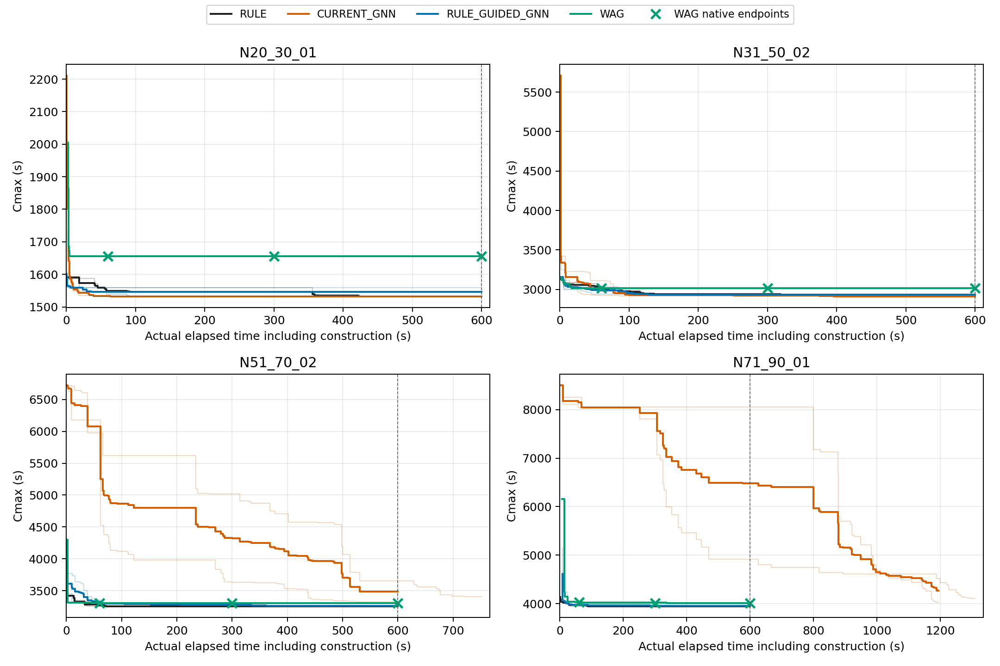

# 规则—GNN长预算与排序贡献诊断

研究目标为开发能够超过RULE、WAG+VNS和HGA的协同方法；本轮仅作开发诊断，不训练、不改变网络结构。
运行环境：D:\pybullet_test\.venv\Scripts\python.exe。固定CONFIG_05、FORMAL_SCOPE_V2、B32、严格P+M下界剪枝和MODE_NEW原接受规则。只读取已消费验证几何；holdout和ID_TEST_SEALED均不载入。

## 主要结论与决定

1. **长预算有效，但不能普遍追平强对照。** 600秒下，CURRENT_GNN相对RULE的几何配对胜/平/负为1/1/2，相对WAG为2/0/2。原融合相对RULE为1/0/3，相对WAG为4/0/0。固定1000次与等600秒的结论不可混用；80条实例的CURRENT完成1000次需约1194–1310秒。
2. **当前GNN的大规模初解发生机器人分配塌缩。** 60、80条几何只使用两台机器人，初始Cmax几乎等于P+MOVE下界，主要损失来自分工与空走而非初始协调等待。动作重放还显示早期决策收缩了后续合法分配机会，并非所有闲置都能归因于后期单次logit偏置。MODE_NEW随后承担重分配，部分路径B32耗时占比超过90%。单纯延长预算在消化初解质量欠账。
3. **扩训输出有变化，完整方案收益没有同步出现。** 同池审计排除了“输出完全不变”和“GNN完全被覆盖”。六个配对仍选旧分支，完整初解、200次终解及接受顺序相同；80条两个配对选第三候选，扩训后初始与200次质量均更差。相同初解下60秒结果的微小差异来自完成迭代数，不归因为模型训练收益。
4. **神经排序有独立决策，独立收益不稳定。** 原融合相对纯规则排序，初始为1/0/3，固定200次为2/0/2。纯GNN排序有一条三候选均DEADLOCK的初始化失败，未补采样或将失败排除后冒充全组表现。
5. **已实现并实测规则成本锚定，未升级为默认策略。** 冻结权重、成本相同时GNN排序的尝试，相对纯规则排序的初始为1/2/1，固定200次为1/0/3。这项负结果保留在代码和CSV中；局部P+MOVE成本同序不能保证完整路线的真实协调Cmax改善。60条几何初始中位Cmax为4743.113，P+MOVE下界为3802.855，协调增量为940.258秒。
6. **下一次只改一个核心机制：训练目标。** 在现有joint_action_logits头上学习相对于规则完整方案的真实B32 Cmax收益，保留规则空间分工作为锚点，以现有可行完整教师及动作轨迹提供相对监督。具体位置为scripts/run_gnn_shared_construction.py的research_train插入动作损失（当前第683行起）；本轮已实现的推理锚定入口位于src/mrta_search/gnn_constructor.py的rule_anchored_action_logits（第799行起）。仅将所有logit减去规则动作logit是常数平移，不改变排序或softmax，不能称为有效残差学习。本轮不训练、不新建权重，不增加网络层。

本轮是已消费验证集上的针对性诊断，尚未建立可作为论文主算法的稳定规则—GNN独立收益；HGA本轮未重新运行。


## 实验口径

选取24、40、60、80条焊缝的四个已消费验证几何，各用20261901、20261902两个种子。60、80条实例包含此前CURRENT_GNN明显落后的情况，属于针对问题的开发选择，不作为新独立测试。
MODE_NEW初始化及搜索的deadline均取消；一条连续、确定种子路径在200/500/1000迭代处保存精确前缀，达到1000次后若尚不足600秒则继续同一路径；达到600秒时若不足1000次则继续至1000次。最大迭代数只控制停止，未参与动作、随机种子或接受计算。新增默认关闭的检查点已作前缀一致性单元测试。
墙钟从模型加载/初始化开始，Excel载入不计入；60/300/600秒取当时已完成的B32可行最优解，绝不把截止后改善追溯计入。固定迭代结果与等时间结果分开列出。
WAG使用现有原生算法与默认配置，分别独立执行60、300、600秒预算。其deadline会影响内部路径构造，所以短预算独立端点不冒充600秒运行的前缀。无额外认证、代理Cmax或二次评价。
最多4个单线程worker并发，任务顺序轮换。实际计时受机器负载影响，小幅时间差不直接解释为算法优势。

已完成：MODE_NEW 24/24，WAG 24/24，受控排序 24/24，同池动作审计 8/8，规则锚定尝试 8/8。

## 固定迭代结果

下表先在同一几何的两个种子内取中位数；秒数为到达该迭代的实际总耗时，包含初始化。固定迭代不表示等时间。

|几何|方法|初始Cmax|200次Cmax/秒|500次Cmax/秒|1000次Cmax/秒|初始可行种子|
|---|---|---:|---:|---:|---:|---:|
|VALIDATION_N20_30_01|RULE|1593.176|1590.649/12.591|1573.447/31.225|1549.162/63.810|2/2|
|VALIDATION_N20_30_01|CURRENT_GNN|2102.953|1548.441/15.759|1536.155/35.406|1532.472/69.883|2/2|
|VALIDATION_N20_30_01|RULE_GUIDED_GNN|1601.732|1558.772/13.549|1548.331/33.083|1545.622/66.228|2/2|
|VALIDATION_N31_50_02|RULE|3131.857|3055.179/33.725|3005.999/73.881|2943.815/121.492|2/2|
|VALIDATION_N31_50_02|CURRENT_GNN|3419.175|2960.121/62.130|2935.775/86.316|2926.285/126.556|2/2|
|VALIDATION_N31_50_02|RULE_GUIDED_GNN|3158.642|3021.671/31.143|2984.963/67.260|2941.919/112.998|2/2|
|VALIDATION_N51_70_02|RULE|3424.926|3287.694/35.945|3273.054/61.184|3257.659/98.095|2/2|
|VALIDATION_N51_70_02|CURRENT_GNN|6721.141|4543.849/213.315|3612.538/480.403|3466.093/589.766|2/2|
|VALIDATION_N51_70_02|RULE_GUIDED_GNN|3613.370|3329.367/50.093|3297.352/77.609|3293.024/115.851|2/2|
|VALIDATION_N71_90_01|RULE|4042.431|4018.226/17.646|3974.499/44.889|3970.043/84.446|2/2|
|VALIDATION_N71_90_01|CURRENT_GNN|8500.566|6485.454/602.593|4570.659/1026.269|4067.528/1251.621|2/2|
|VALIDATION_N71_90_01|RULE_GUIDED_GNN|4079.137|3984.881/28.520|3974.962/59.478|3968.528/110.812|2/2|

## 等实际时间结果

三个MODE_NEW方法使用连续运行的墙钟检查点；WAG列使用各预算的原生独立运行端点。两种子均有可行解才报告中位数。

|几何|方法|60秒Cmax|300秒Cmax|600秒Cmax|
|---|---|---:|---:|---:|
|VALIDATION_N20_30_01|RULE|1549.162|1545.622|1532.472|
|VALIDATION_N20_30_01|CURRENT_GNN|1533.999|1532.472|1532.472|
|VALIDATION_N20_30_01|RULE_GUIDED_GNN|1545.622|1545.622|1545.622|
|VALIDATION_N20_30_01|WAG|1656.227|1656.227|1656.227|
|VALIDATION_N31_50_02|RULE|3011.249|2938.271|2932.552|
|VALIDATION_N31_50_02|CURRENT_GNN|3015.546|2925.070|2913.172|
|VALIDATION_N31_50_02|RULE_GUIDED_GNN|2989.481|2931.737|2931.693|
|VALIDATION_N31_50_02|WAG|3015.186|3015.186|3014.784|
|VALIDATION_N51_70_02|RULE|3273.054|3256.513|3256.513|
|VALIDATION_N51_70_02|CURRENT_GNN|6075.956|4326.360|3489.874|
|VALIDATION_N51_70_02|RULE_GUIDED_GNN|3326.667|3276.758|3260.880|
|VALIDATION_N51_70_02|WAG|3308.783|3306.355|3306.355|
|VALIDATION_N71_90_01|RULE|3972.050|3944.470|3944.393|
|VALIDATION_N71_90_01|CURRENT_GNN|8147.398|7932.167|6485.454|
|VALIDATION_N71_90_01|RULE_GUIDED_GNN|3974.962|3959.264|3957.537|
|VALIDATION_N71_90_01|WAG|4036.086|4008.751|4008.751|



粗线为两种子同时有观测时的中位轨迹，细线保留各自完整轨迹；WAG轨迹为600秒原生运行，叉号为各独立预算端点。竖虚线标记600秒；若某方法完成1000次耗时更长，600秒后的曲线属于固定迭代诊断，不能与已停止的其他方法解释为等时间比较。只在两个种子均已可行时画中位线。

轨迹保留初始化过程中的可行候选改善；表格“初始Cmax”指完整初始化结束后的最优值。

## Portfolio实际获胜来源

三个提案固定为0=旧模型greedy、1=旧模型sample、2=refinement模型greedy。所有GNN组最多三次初始B32；重复方案和数学下界剪枝会减少实际调用。未调度候选的Cmax保持空值。任务一使用原checkpoint；扩训checkpoint仅在受控消融中替换第三个提案。

|几何|种子|策略|获胜提案|初始Cmax|初始B32|提案状态0/1/2|
|---|---:|---|---:|---:|---:|---|
|VALIDATION_N20_30_01|20261901|RULE_GUIDED_GNN|0|1601.732|2|FEASIBLE / PRUNED_BY_CMAX_LB / DEADLOCK|
|VALIDATION_N20_30_01|20261901|CURRENT_GNN|0|2212.028|2|FEASIBLE / DEADLOCK / PRUNED_BY_CMAX_LB|
|VALIDATION_N31_50_02|20261901|CURRENT_GNN|2|3419.175|2|FEASIBLE / PRUNED_BY_CMAX_LB / FEASIBLE|
|VALIDATION_N51_70_02|20261901|RULE_GUIDED_GNN|1|3458.523|2|FEASIBLE / FEASIBLE / PRUNED_BY_CMAX_LB|
|VALIDATION_N31_50_02|20261901|RULE_GUIDED_GNN|0|3159.329|1|FEASIBLE / PRUNED_BY_CMAX_LB / PRUNED_BY_CMAX_LB|
|VALIDATION_N71_90_01|20261901|RULE_GUIDED_GNN|2|4079.137|3|DEADLOCK / DEADLOCK / FEASIBLE|
|VALIDATION_N51_70_02|20261901|CURRENT_GNN|0|6721.141|3|FEASIBLE / DEADLOCK / DEADLOCK|
|VALIDATION_N20_30_01|20261902|CURRENT_GNN|1|1993.879|2|FEASIBLE / FEASIBLE / PRUNED_BY_CMAX_LB|
|VALIDATION_N20_30_01|20261902|RULE_GUIDED_GNN|0|1601.732|2|FEASIBLE / PRUNED_BY_CMAX_LB / DEADLOCK|
|VALIDATION_N71_90_01|20261901|CURRENT_GNN|0|8500.566|2|FEASIBLE / PRUNED_BY_CMAX_LB / DEADLOCK|
|VALIDATION_N31_50_02|20261902|RULE_GUIDED_GNN|1|3157.955|2|FEASIBLE / FEASIBLE / PRUNED_BY_CMAX_LB|
|VALIDATION_N31_50_02|20261902|CURRENT_GNN|2|3419.175|2|FEASIBLE / PRUNED_BY_CMAX_LB / FEASIBLE|
|VALIDATION_N51_70_02|20261902|CURRENT_GNN|0|6721.141|3|FEASIBLE / DEADLOCK / DEADLOCK|
|VALIDATION_N51_70_02|20261902|RULE_GUIDED_GNN|0|3768.218|1|FEASIBLE / PRUNED_BY_CMAX_LB / PRUNED_BY_CMAX_LB|
|VALIDATION_N71_90_01|20261902|RULE_GUIDED_GNN|2|4079.137|3|DEADLOCK / FEASIBLE / FEASIBLE|
|VALIDATION_N71_90_01|20261902|CURRENT_GNN|0|8500.566|2|FEASIBLE / PRUNED_BY_CMAX_LB / DEADLOCK|
|VALIDATION_N20_30_01|20261901|RULE_RANK|0|1605.864|1|FEASIBLE / PRUNED_BY_CMAX_LB / DUPLICATE|
|VALIDATION_N20_30_01|20261901|RULE_GUIDED_GNN_EXPANDED|0|1601.732|1|FEASIBLE / PRUNED_BY_CMAX_LB / PRUNED_BY_CMAX_LB|
|VALIDATION_N20_30_01|20261901|GNN_RANK|2|2212.028|3|FEASIBLE / FEASIBLE / FEASIBLE|
|VALIDATION_N31_50_02|20261901|GNN_RANK|0|5675.513|3|FEASIBLE / DEADLOCK / DEADLOCK|
|VALIDATION_N31_50_02|20261901|RULE_GUIDED_GNN_EXPANDED|0|3159.329|2|FEASIBLE / PRUNED_BY_CMAX_LB / DEADLOCK|
|VALIDATION_N51_70_02|20261901|RULE_GUIDED_GNN_EXPANDED|1|3458.523|2|FEASIBLE / FEASIBLE / PRUNED_BY_CMAX_LB|
|VALIDATION_N31_50_02|20261901|RULE_RANK|0|3126.533|1|FEASIBLE / PRUNED_BY_CMAX_LB / DUPLICATE|
|VALIDATION_N71_90_01|20261901|RULE_RANK|0|4063.399|1|FEASIBLE / PRUNED_BY_CMAX_LB / DUPLICATE|
|VALIDATION_N51_70_02|20261901|GNN_RANK|2|4352.669|3|FEASIBLE / FEASIBLE / FEASIBLE|
|VALIDATION_N51_70_02|20261901|RULE_RANK|0|3544.744|2|FEASIBLE / DEADLOCK / DUPLICATE|
|VALIDATION_N71_90_01|20261901|RULE_GUIDED_GNN_EXPANDED|2|4136.173|3|DEADLOCK / DEADLOCK / FEASIBLE|
|VALIDATION_N20_30_01|20261902|GNN_RANK|2|2212.028|2|FEASIBLE / PRUNED_BY_CMAX_LB / FEASIBLE|
|VALIDATION_N20_30_01|20261902|RULE_GUIDED_GNN_EXPANDED|0|1601.732|1|FEASIBLE / PRUNED_BY_CMAX_LB / PRUNED_BY_CMAX_LB|
|VALIDATION_N20_30_01|20261902|RULE_RANK|1|1605.677|2|FEASIBLE / FEASIBLE / DUPLICATE|
|VALIDATION_N31_50_02|20261902|RULE_GUIDED_GNN_EXPANDED|1|3157.955|2|FEASIBLE / FEASIBLE / PRUNED_BY_CMAX_LB|
|VALIDATION_N71_90_01|20261901|GNN_RANK|1|8474.318|3|DEADLOCK / FEASIBLE / DEADLOCK|
|VALIDATION_N31_50_02|20261902|RULE_RANK|0|3126.533|1|FEASIBLE / PRUNED_BY_CMAX_LB / DUPLICATE|
|VALIDATION_N51_70_02|20261902|RULE_RANK|1|3478.010|2|FEASIBLE / FEASIBLE / DUPLICATE|
|VALIDATION_N71_90_01|20261902|GNN_RANK|None|—|3|DEADLOCK / DEADLOCK / DEADLOCK|
|VALIDATION_N51_70_02|20261902|GNN_RANK|2|4352.669|2|FEASIBLE / PRUNED_BY_CMAX_LB / FEASIBLE|
|VALIDATION_N31_50_02|20261902|GNN_RANK|1|5006.643|3|FEASIBLE / FEASIBLE / DEADLOCK|
|VALIDATION_N51_70_02|20261902|RULE_GUIDED_GNN_EXPANDED|0|3768.218|1|FEASIBLE / PRUNED_BY_CMAX_LB / PRUNED_BY_CMAX_LB|
|VALIDATION_N71_90_01|20261902|RULE_GUIDED_GNN_EXPANDED|2|4136.173|3|DEADLOCK / FEASIBLE / FEASIBLE|
|VALIDATION_N71_90_01|20261902|RULE_RANK|0|4063.399|1|FEASIBLE / PRUNED_BY_CMAX_LB / DUPLICATE|
|VALIDATION_N20_30_01|20261901|RULE_ANCHORED_GNN|0|1593.176|1|FEASIBLE / PRUNED_BY_CMAX_LB / PRUNED_BY_CMAX_LB|
|VALIDATION_N31_50_02|20261901|RULE_ANCHORED_GNN|0|3126.533|1|FEASIBLE / PRUNED_BY_CMAX_LB / PRUNED_BY_CMAX_LB|
|VALIDATION_N71_90_01|20261901|RULE_ANCHORED_GNN|0|4063.399|1|FEASIBLE / PRUNED_BY_CMAX_LB / PRUNED_BY_CMAX_LB|
|VALIDATION_N51_70_02|20261901|RULE_ANCHORED_GNN|0|5062.161|3|FEASIBLE / DEADLOCK / DEADLOCK|
|VALIDATION_N20_30_01|20261902|RULE_ANCHORED_GNN|0|1593.176|1|FEASIBLE / PRUNED_BY_CMAX_LB / PRUNED_BY_CMAX_LB|
|VALIDATION_N31_50_02|20261902|RULE_ANCHORED_GNN|0|3126.533|1|FEASIBLE / PRUNED_BY_CMAX_LB / PRUNED_BY_CMAX_LB|
|VALIDATION_N71_90_01|20261902|RULE_ANCHORED_GNN|0|4063.399|1|FEASIBLE / PRUNED_BY_CMAX_LB / PRUNED_BY_CMAX_LB|
|VALIDATION_N51_70_02|20261902|RULE_ANCHORED_GNN|1|4424.065|3|FEASIBLE / FEASIBLE / DEADLOCK|

## 受控排序消融

三种排序均采用MRV父选择和同一个合法动作生成函数。pure GNN与pure rule都转为负序号后采样，与融合的采样尺度一致；CURRENT_GNN保持原始logits采样和学习父选择，不能把其差异全部归给插入排名。RULE_RANK是GNN构造流程内的规则排序消融，RULE仍使用common_initial_beam。pure rule仍计算网络输出以保持执行路径可比，但决策不使用网络排名；没有减少任何合法动作。融合原权重的200次结果复用任务一精确前缀；其余组运行至少200次及60秒，同样不作二次B32认证。

RULE_ANCHORED_GNN是诊断后新增的一项保守尝试：规则成本(归属偏好,max P+MOVE,sum P+MOVE)作为主序，成本完全相同时按GNN logits排序；全部候选仍具有有限排名，采样规则与三提案上限相同。它使用原冻结权重，不是经过训练的Cmax残差模型；没有引入容差、融合权重或新网络。

|几何|排序|初始Cmax|200次最终Cmax|到200次秒|60秒Cmax|可行种子|
|---|---|---:|---:|---:|---:|---:|
|VALIDATION_N20_30_01|RULE_RANK|1605.770|1563.639|12.462|1558.772|2/2|
|VALIDATION_N20_30_01|GNN_RANK|2212.028|1592.285|15.726|1559.247|2/2|
|VALIDATION_N20_30_01|RULE_GUIDED_GNN|1601.732|1558.772|13.549|1545.622|2/2|
|VALIDATION_N20_30_01|RULE_GUIDED_GNN_EXPANDED|1601.732|1558.772|13.323|1545.622|2/2|
|VALIDATION_N20_30_01|RULE_ANCHORED_GNN|1593.176|1590.649|15.181|1559.035|2/2|
|VALIDATION_N31_50_02|RULE_RANK|3126.533|2989.715|29.728|2955.637|2/2|
|VALIDATION_N31_50_02|GNN_RANK|5341.078|4256.392|99.419|4720.879|2/2|
|VALIDATION_N31_50_02|RULE_GUIDED_GNN|3158.642|3021.671|31.143|2989.481|2/2|
|VALIDATION_N31_50_02|RULE_GUIDED_GNN_EXPANDED|3158.642|3021.671|29.306|2988.578|2/2|
|VALIDATION_N31_50_02|RULE_ANCHORED_GNN|3126.533|2958.017|36.635|2953.278|2/2|
|VALIDATION_N51_70_02|RULE_RANK|3511.377|3330.533|76.126|3373.362|2/2|
|VALIDATION_N51_70_02|GNN_RANK|4352.669|3394.296|62.292|3397.467|2/2|
|VALIDATION_N51_70_02|RULE_GUIDED_GNN|3613.370|3329.367|50.093|3326.667|2/2|
|VALIDATION_N51_70_02|RULE_GUIDED_GNN_EXPANDED|3613.370|3329.367|47.012|3304.227|2/2|
|VALIDATION_N51_70_02|RULE_ANCHORED_GNN|4743.113|3377.141|82.618|3393.337|2/2|
|VALIDATION_N71_90_01|RULE_RANK|4063.399|3963.385|28.534|3958.019|2/2|
|VALIDATION_N71_90_01|GNN_RANK|—|—|—|—|1/2|
|VALIDATION_N71_90_01|RULE_GUIDED_GNN|4079.137|3984.881|28.520|3974.962|2/2|
|VALIDATION_N71_90_01|RULE_GUIDED_GNN_EXPANDED|4136.173|4036.198|32.126|3980.651|2/2|
|VALIDATION_N71_90_01|RULE_ANCHORED_GNN|4063.399|4013.513|25.852|3993.216|2/2|

扩训模型只更换第三个提案，而MODE_NEW后端不使用网络。下面按同几何、同种子直接比较完整状态与接受顺序，避免将相同初解下的墙钟迭代速度差当成模型质量变化。

|几何|相同初始完整方案/配对数|相同200次完整终解/配对数|相同前200次接受轨迹/配对数|
|---|---:|---:|---:|
|VALIDATION_N20_30_01|2/2|2/2|2/2|
|VALIDATION_N31_50_02|2/2|2/2|2/2|
|VALIDATION_N51_70_02|2/2|2/2|2/2|
|VALIDATION_N71_90_01|0/2|0/2|0/2|

## 完全相同动作池的反事实诊断

在每个规则、GNN、融合驱动路径上，逐步保留相同prefix与variants，分别计算规则、GNN和融合top1；另用原refinement与扩训refinement对相同池评分。审计不调用B32，也不并入正式算法计时。这些比例是同池决策一致率，不是不同路径上恰好相同的动作数。

|几何|动作池数|规则=GNN/%|规则=融合/%|GNN=融合/%|扩训改变GNN top1/%|扩训改变融合top1/%|
|---|---:|---:|---:|---:|---:|---:|
|VALIDATION_N20_30_01|432|43.52|67.82|57.41|43.06|28.94|
|VALIDATION_N31_50_02|900|23.22|46.89|52.67|30.78|23.11|
|VALIDATION_N51_70_02|1080|28.24|57.87|48.89|30.56|18.15|
|VALIDATION_N71_90_01|1530|20.00|46.08|43.66|26.60|26.60|

|几何|logits发生数值变化的池/%|完整GNN排序变化的池/%|平均绝对logit变化|
|---|---:|---:|---:|
|VALIDATION_N20_30_01|100.00|91.67|7.326853|
|VALIDATION_N31_50_02|100.00|97.89|4.389284|
|VALIDATION_N51_70_02|100.00|98.33|9.166289|
|VALIDATION_N71_90_01|100.00|98.56|7.707215|

扩训checkpoint的旧模型分支逐tensor与原文件比较：True；refinement改变tensor数：[24]。

只取融合驱动路径的实际选中动作，进一步区分空间归属与顺序/方向贡献。P+MOVE差为同状态下相对于规则动作的差，不是完整B32调度收益。动作池之间有路径依赖，不当作独立统计样本。

|几何|规则归属一致/%|比规则动作更大max(P+MOVE)的比例/%|平均max(P+MOVE)差/秒|
|---|---:|---:|---:|
|VALIDATION_N20_30_01|99.31|4.86|0.254|
|VALIDATION_N31_50_02|95.67|20.00|7.893|
|VALIDATION_N51_70_02|97.22|7.50|1.941|
|VALIDATION_N71_90_01|95.29|14.90|-2.605|

## 初始调度劣势来源

仅对已保存的初始完整方案计算既有P+MOVE严格下界，不新增B32评价。Cmax−LB只帮助区分机器人自身负载/空走与协调等待，LB仍不代替正式Cmax。

|几何|方法|初始Cmax|P+MOVE下界|Cmax−LB|四机器人P+MOVE中位数|
|---|---|---:|---:|---:|---|
|VALIDATION_N20_30_01|RULE|1593.176|1593.176|0.000|[1593.176, 1558.772, 887.678, 1444.962]|
|VALIDATION_N20_30_01|CURRENT_GNN|2102.953|2102.953|0.000|[1420.014, 1817.512, 2102.953, 171.545]|
|VALIDATION_N20_30_01|RULE_GUIDED_GNN|1601.732|1601.732|0.000|[1601.732, 1563.772, 891.712, 1444.962]|
|VALIDATION_N20_30_01|RULE_ANCHORED_GNN|1593.176|1593.176|0.000|[1593.176, 1558.989, 887.678, 1444.962]|
|VALIDATION_N31_50_02|RULE|3131.857|3131.857|0.000|[2888.508, 2643.186, 3131.857, 2905.031]|
|VALIDATION_N31_50_02|CURRENT_GNN|3419.175|3419.175|0.000|[2218.529, 3419.175, 3241.050, 2929.717]|
|VALIDATION_N31_50_02|RULE_GUIDED_GNN|3158.642|3158.642|0.000|[2596.904, 2992.327, 3158.642, 2911.113]|
|VALIDATION_N31_50_02|RULE_ANCHORED_GNN|3126.533|3126.533|0.000|[2880.402, 2634.943, 3126.533, 2900.014]|
|VALIDATION_N51_70_02|RULE|3424.926|3424.926|0.000|[2139.797, 2117.006, 3424.926, 3092.883]|
|VALIDATION_N51_70_02|CURRENT_GNN|6721.141|6721.141|0.000|[0.000, 4392.565, 0.000, 6721.141]|
|VALIDATION_N51_70_02|RULE_GUIDED_GNN|3613.370|3445.093|168.277|[2141.320, 2125.870, 3445.093, 3118.474]|
|VALIDATION_N51_70_02|RULE_ANCHORED_GNN|4743.113|3802.855|940.258|[2129.312, 2128.475, 3802.855, 2739.136]|
|VALIDATION_N71_90_01|RULE|4042.431|4042.431|0.000|[3539.496, 3635.670, 4020.509, 4042.431]|
|VALIDATION_N71_90_01|CURRENT_GNN|8500.566|8500.566|0.000|[0.000, 7589.658, 0.000, 8500.566]|
|VALIDATION_N71_90_01|RULE_GUIDED_GNN|4079.137|4079.137|0.000|[3577.533, 3672.935, 4051.829, 4079.137]|
|VALIDATION_N71_90_01|RULE_ANCHORED_GNN|4063.399|4063.399|0.000|[3552.615, 3647.328, 4014.304, 4063.399]|

## 早期决策与合法动作池收缩

用现有prepare_joint_teacher_steps重放已保存的CURRENT_GNN获胜动作，不调用B32、不重新推理、不放宽合法性约束。统计同轨另一台机器人在几何上可用时，是否仍出现在当前合法动作池。这是路径诊断，不是新增可行性认证。N60的大部分另一机器人选择已被早期决策后的合法性约束排除；N80仍有大量双机器人选择机会，故分配塌缩同时包含动作池收缩和神经决策偏置。

|几何|另一机器人仍有动作/几何可用次数|规则偏好机器人不可用/动作数|
|---|---:|---:|
|VALIDATION_N20_30_01|41/48|1/48|
|VALIDATION_N31_50_02|88/100|0/100|
|VALIDATION_N51_70_02|8/120|42/120|
|VALIDATION_N71_90_01|98/170|16/170|

## 完整路径成本与失败

下表为两种子中位数；MODE_NEW完成至少1000次且覆盖600秒，WAG为原生600秒运行，故此处迭代数不能跨算法当作相同工作量。每条原始记录、其他WAG预算及消融成本见CSV。

|几何|方法|初始化秒|搜索秒|实际秒|B32次数/秒|实际迭代数|
|---|---|---:|---:|---:|---:|---:|
|VALIDATION_N20_30_01|RULE|0.381|599.658|600.038|26.000/2.822|9392.500|
|VALIDATION_N20_30_01|CURRENT_GNN|0.452|599.583|600.035|25.500/3.174|8843.500|
|VALIDATION_N20_30_01|RULE_GUIDED_GNN|0.437|599.596|600.033|15.500/1.402|9233.500|
|VALIDATION_N20_30_01|WAG_600|2.891|597.225|600.116|2688.500/349.571|127.500|
|VALIDATION_N31_50_02|RULE|1.698|598.372|600.070|118.500/50.257|7281.000|
|VALIDATION_N31_50_02|CURRENT_GNN|0.754|599.339|600.093|97.500/52.446|7253.000|
|VALIDATION_N31_50_02|RULE_GUIDED_GNN|0.909|599.126|600.035|99.000/36.416|7339.500|
|VALIDATION_N31_50_02|WAG_600|2.712|597.409|600.121|1104.000/271.115|40.000|
|VALIDATION_N51_70_02|RULE|3.470|596.574|600.044|56.500/25.109|8081.500|
|VALIDATION_N51_70_02|CURRENT_GNN|2.441|673.271|675.712|449.000/542.571|1834.500|
|VALIDATION_N51_70_02|RULE_GUIDED_GNN|2.239|597.779|600.018|106.500/59.693|7448.000|
|VALIDATION_N51_70_02|WAG_600|2.766|597.539|600.305|588.500/251.246|28.500|
|VALIDATION_N71_90_01|RULE|1.479|598.528|600.008|39.500/16.303|8661.000|
|VALIDATION_N71_90_01|CURRENT_GNN|4.965|1246.661|1251.626|611.000/1183.299|1000.000|
|VALIDATION_N71_90_01|RULE_GUIDED_GNN|7.778|592.248|600.026|39.500/35.936|7333.500|
|VALIDATION_N71_90_01|WAG_600|10.939|589.351|600.290|319.500/238.497|15.500|

GNN_RANK在80条几何第二种子的三次初始B32均返回DEADLOCK，菜单耗尽，不代表几何不可行，也不是60秒截止或下界剪枝造成。diagnostic_wag_smoke是开发1秒探针：早期KeyError已修复，原始错误及修复后预算内无可行解记录均保留，不混入正式WAG可行率。

失败：diagnostic_wag_smoke / VALIDATION_N20_30_01 / WAG_1 / 20261901
```text
Traceback (most recent call last):
  File "D:\pybullet_test\MRTA_GA\DRL\scripts\run_rule_guided_gnn.py", line 1064, in diagnostic_wag_worker
    cmax=out.checkpoints[budget]
         ~~~~~~~~~~~~~~~^^^^^^^^
KeyError: 1

```

失败：diagnostic_wag_smoke / VALIDATION_N20_30_01 / WAG_1 / 20261901
```text
budget=1s, termination=INITIALIZATION_FAILED, B32 calls=3
```

失败：ranking_ablation / VALIDATION_N71_90_01 / GNN_RANK / 20261902
```text
proposal 0: previous/greedy, status=DEADLOCK, B32=1, elapsed=1.0755613000364974
proposal 1: previous/sample, status=DEADLOCK, B32=1, elapsed=2.0823933000210673
proposal 2: refinement/greedy, status=DEADLOCK, B32=1, elapsed=4.167789500090294
```

## 软件验证

PYTEST：PASSED，560项，46.88秒。
```powershell
Set-Location 'D:\pybullet_test\MRTA_GA'
$env:PYTHONPATH = (Join-Path (Get-Location) 'DRL\src')
& 'D:\pybullet_test\.venv\Scripts\python.exe' -B -m pytest -q -p no:cacheprovider DRL\tests
```


CSV保存逐次改善时间、完整200/500/1000次方案、候选来源、动作审计、B32状态及计次；旧正式实验CSV、checkpoint和旧报告均不写入。

## 运行与续跑

现有CSV中的成功和失败均保留；重复执行只补缺失的运行，不覆盖旧记录。

```powershell
Set-Location 'D:\pybullet_test\MRTA_GA\DRL'
$env:PYTHONPATH = (Join-Path (Get-Location) 'src')
$diagnosticPython = 'D:\pybullet_test\.venv\Scripts\python.exe'
foreach ($diagnosticPhase in @('long_mode','long_wag','ranking_ablation','action_audit','anchored','diagnostic_report')) {
    & $diagnosticPython -B scripts/run_rule_guided_gnn.py --phase $diagnosticPhase --workers 4
}
```
