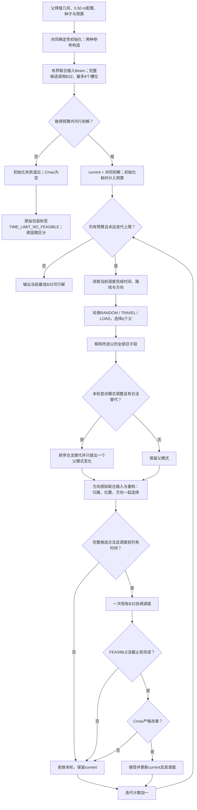

# MODE_NEW最终算法技术说明

日期：2026-11-04。本文说明现有代码中已经执行500次正式比较时所用的MODE_NEW，不提出新的算法。实验结果以[项目总报告](PROJECT_FINAL_REPORT_20261104.md)为主，初始化失败证据见[HIGH_WORKLOAD_04根因报告](HIGH_WORKLOAD_04_ROOT_CAUSE.md)。

## 1. 问题表示与整体思想

场景为双滑轨四机器人系统。R0/R1属于上轨，R2/R3属于下轨。父焊缝保存原始起止点；父模式决定是否及如何形成子焊缝。完整解同时包含每个父的模式、四条子焊缝路线以及与路线逐项对应的0/1方向向量。方向0为该子段保存端点start→end，方向1为end→start。

优化目标是最小化B32返回的系统最大完工时间Cmax=max(C0,C1,C2,C3)。父模式会改变子段数量、机器人资格及每段前后处理成本；归属改变各机器人的任务集合；顺序与方向共同改变入口、出口和空走；协调调度还会产生WAIT。因此，单独最小化某条路线的空走或只平衡加工负载，都不能代替完整候选的B32调度结果。

本方法把方向作为每次插入动作的一部分。不存在“先排好序、再调用独立方向优化器”的主方法阶段，也不存在独立WAIT优化阶段。FIXED_NEW保留同样的初始解、选择、联合修复、B32与接受规则，只禁止改变父模式。

## 2. 当前科学与搜索配置

|参数|实际配置/含义|
|---|---|
|工作区域|20 m×12 m|
|机器人|上轨R0/R1，下轨R2/R3|
|最短子焊缝|0.50 m|
|X/Y拆分窗口|delta_x=delta_y=0.50 m|
|轨间任务覆盖带|By=[5.5,6.5] m，按现有资格模型处理|
|干涉参数|interference_dx=interference_dy=0.50 m|
|焊接速度|0.0108 m/s|
|空走速度|0.20 m/s|
|每段前置/后置时间|20 s / 30 s|
|模式目录|FORMAL_SCOPE_V2的有限合法WHOLE/Y_SPLIT/X_SPLIT目录|
|调度评价|现有B32，正式实验certify=False|
|正式评价预算|60 s，含共同初始化；开发消融为30 s|
|共同初始化|两种参考构造，每种Beam宽度最多4；插入位置限制8|
|父移除数q|按三轮一组交替4/8，且不超过父数量|
|联合插入位置限制|8|
|单次联合修复的局部插入评估上限|4096，不是4096次B32|
|内部方向版本数|2，属于联合修复的内部状态|
|迭代上限|1,000,000，实际主要由时间预算限制|

来源：[ScientificConfig](../src/mrta_reference/model.py#L64)、[CONFIG与CONFIG_05](../scripts/run_gnn_multi_initial.py#L27)、[_mode_search](../scripts/run_gnn_multi_initial.py#L347)。历史全局CONFIG=0.20继续存在；本次正式入口显式传入CONFIG_05=ScientificConfig()。独立对比中的REGION也显式使用CONFIG_05，不能从历史CONFIG_V05的默认值推断本次配置。

加工负载定义为P_r=Σ(20+L_b/0.0108+30)，包含SETUP、WELD和POST。MOVE使用定向端点间距离/0.20；WAIT直接取调度操作时长，不用差值估计。

## 3. 共同确定性初始化

调用链为[_final_experiment_worker](../scripts/run_gnn_multi_initial.py#L3173) → [common_initial_beam](../scripts/run_joint_oriented_repair_pilot.py#L152) → [initial_reference](../scripts/run_joint_oriented_repair_pilot.py#L145)与[build_oriented_insertion_beam](../src/mrta_search/initialization.py#L132)。

“确定性”表示规则构造、无神经模型，在给定几何、配置和种子下可复现；插入方向组合的遍历仍使用传入种子的局部随机数发生器，不能声称所有种子都会给出相同路线。

### 3.1 两种参考任务分配

1. **REGION_LOCAL**：合法WHOLE优先，不可整段执行的父选择合法强制Y模式。固定资格任务进入对应轨，柔性任务按三种固定顺序考察轨间分配：加工量递减、沿X正序、沿X逆序。每轨按连续X边界分成左右机器人区域。边界的主要代理为max(P)+0.10×max(M)+0.02×X重叠/empty_speed，并以负载差、空走和边界序号等打破平局；最后只输出一套参考归属。正式共同初始化传入局部方向插入成本，并设置improve_routes=False，不执行该通用区域构造中可选的路线改良/方向DP。
2. **RULE_X_LOCAL**：调用construct_solution(..., model=None)。先按合法轨资格分组，双轨可达任务按加工量递减分给较轻轨；每轨按子段X中点排序，选择最小化最大加工负载的连续边界，再形成确定性参考顺序。该名字不表示初始化将父焊缝切为X_SPLIT。

来源：[区域参考构造](../src/mrta_search/initialization.py#L1081)、[区域边界代理](../src/mrta_search/initialization.py#L1027)、[rule_assignment](../src/mrta_search/gnn_constructor.py#L791)、[规则路线构造](../src/mrta_search/gnn_constructor.py#L842)。

### 3.2 联合插入Beam

对每个参考构造，保留父模式与每个子段的机器人归属，从四条空路线开始，按参考路线的深度轮流取待插子段。对其所属机器人枚举有界插入位置，并同时确定新子段及相邻子段的方向；按估计完成时间Q_r=P_r+M_r，先最小化max(Q_r)，再最小化ΣQ_r。

每层最多保留4个部分状态，优先保留不同路线顺序；不足时，同一路线最多补入2种方向。没有调用完整路线方向DP。Beam内部几何/方向插入不调用B32，只有完成候选才调用一次schedule_explicit。

正式入口以interleave=True轮流评价REGION[0]、RULE[0]、REGION[1]、RULE[1]……最多8个槽位。某一对完成后已有可行候选则停止，取已接纳候选中Cmax最小者。阶段1的RULE/BEAM另外设置max_reference_calls=4；该四次限制不能误写成正式MODE_NEW也只有四次初始化评价。

MODE_NEW和FIXED_NEW在同一几何/种子下复用同一个已调度共同初解，并等额计入其实际构造耗时，随后分别开始各自搜索。物理上共享一次初始化，不能把两方法行中的初始调用计次重复解释成独立执行。

### 3.3 初始化失败

若没有可行初始状态，后续父选择与局部修复没有入口，当前代码直接退出。common_initial_beam本身没有REGION通用初始化的串行回退分支。

正式包装将initial=None和elapsed>budget共用TIME_LIMIT_NO_FEASIBLE标签，存在状态分类不精确的问题。HIGH_WORKLOAD_04在27–32秒完成8次有界候选评价后退出，并不是60秒耗尽。本文记录既有行为，不修改其算法或原始状态；最小元数据修复建议单列于根因报告。

## 4. 调度反馈驱动的父焊缝选择

[SELECTORS](../scripts/run_gnn_joint_repair_pilot.py#L33)实际轮换为RANDOM、TRAVEL、LOAD。它不是每轮都选择同一台瓶颈机器人，也不使用WAIT_ANCHORED、阻塞因果图或新的WAIT算子。

以零基迭代k计，局部种子为seed+k，选择器为SELECTORS[k mod 3]；q=min(N, (4,8)[floor(k/3) mod 2])。由[select_bottleneck_parents](../src/mrta_search/lns.py#L475)选择父集合，再通过[_remove_parent_set](../src/mrta_search/lns.py#L391)一次移除这些父的全部旧子段。

- **RANDOM**：现有无放回随机父移除，为探索保留入口。
- **LOAD**：先按P_r×(C_r/max(C))²在非空机器人中加权抽取锚点机器人。优先选择其有合法迁移机会的父，并按这些父在该机器人上的加工时间加权抽取锚点。因此加工负载与真实完成时间共同影响选择。
- **TRAVEL**：根据当前路线相邻子段的真实方向出口/入口计算弧空走成本m，按max(m,1e−9)×(0.25+C_r/max(C))抽取弧，以弧两端父作为锚点。不是简单选择几何距离最大的两条父焊缝。
- **补足关联父**：其余父按与锚点的端点距离、可移动性、可接收机器人及路线邻接关系加权无放回选取。现有权重中含距离与邻接项；当前三个选择器没有WAIT_ANCHORED的时间重叠项输入。

“调度反馈”主要通过B32的机器人完成时间进入LOAD/TRAVEL权重，通过Cmax进入最终接受。WAIT会影响完成时间，但没有被当作独立优化目标或可被此选择器证明的因果阻塞关系。

## 5. 父焊缝模式调整

[build_legal_pattern_catalog](../src/mrta_reference/geometry.py#L40)是同一几何的统一合法目录。父参数表示p(t)=start+t(end−start)。

|模式|子段与资格|
|---|---|
|WHOLE|一个完整子段，必须至少具有一个合法轨资格|
|Y_SPLIT|两个子段；若父没有任何整段轨资格，Y拆分为强制；否则目录中可存在可选Y拆分|
|X_SPLIT|两个指定轨的子段，后续修复固定子段0给该轨左机器人、子段1给右机器人|

当前Y候选来自y=5.5、6.0、6.5的交点及覆盖带内的合法中点；X候选来自各轨固定交接中心±0.50 m、中心及合法中点。固定交接中心由现有frozen_handover_centers按实例几何确定，不随当前路线重新优化。所有切点要求0<t<1、两子段长度均至少0.50 m、机器人资格合法，并按现有规则去重。当前split_axis_offsets只输出配置窗口边界和中心，不额外加入历史±0.20 m内切点；历史显式0.20配置仍保留其原窗口。

在MODE_NEW中，仅当k为奇数（第2、4、6……轮）时尝试模式调整。先对已完整移除的父枚举与当前不同的合法模式/切点；没有替代项时保持原模式。本轮至多改变其中一个父，其他移除父保留原模式后一起重插。按下标floor(k/6) mod 候选数逐步访问排序后的替代项，没有对所有模式逐一调用B32。

[rank_parent_mode_changes](../src/mrta_search/lns.py#L1395)用当前归属负载做廉价排序：扣除目标父旧子段的负载，枚举新子段的合法机器人归属，以预计最大加工负载、预计负载差、新子段总加工成本及稳定的父/模式次序排序。该估计不含实际协调等待，也不是B32可行性检查或后续联合修复的数学下界。实际修复可以重分配整个被移除父集合。

## 6. 方向感知联合插入与重构

调用[repair_partial_state_oriented](../src/mrta_search/lns.py#L1376)，使用既有Regret-2修复循环，参数为insertion_limit=8、max_insertion_evaluations=4096、coordination_proxy=True、direction_versions=2；有模式提案时才传allow_pattern_changes=True。

### 6.1 联合插入动作

一次动作为“子段、机器人、插入位置、方向”四者的共同选择。WHOLE/Y子段仅考虑有资格的机器人，X子段遵守指定左右机器人。位置数最多8个：若路线较短枚举全部，否则在0到路线长度之间取等距取整位置。

[oriented_insert_variants](../src/mrta_search/lns.py#L936)同时枚举新子段方向及插入位置前驱、后继的方向组合，最多涉及3个方向位；不相邻的方向逐项保留。只重算受影响的定向弧，检查起始部署点的现有可行条件。随后在同一插入动作中保留局部较短空走变体。没有在完成排序后独立求方向。

### 6.2 父级原子重插与Regret-2

一个父的全部新子段形成一个完整插入备选，不能只把一部分子段留在原路线。若两子段在同一机器人路线相邻、会被canonicalize合并从而改变目标模式，该备选在构造中排除；模式调整也要求旧子段已完整移除。

对子段合法归属组合分配有界评估配额，再考察插入位置和局部方向。父备选按max(P+M)、Σ(P+M)、路线及方向排序。对每个待插父比较最佳与次佳**不同路线结构**的备选，优先重插Regret-2差距最大的父；只有一个可行结构时优先级相应提高。最多保留2个相同路线结构下的方向状态，随着父插入过程一起推进。

coordination_proxy=True在这里实际启用的是P+MOVE完成时间代理，未计算真实WAIT。方向版本是现有修复内部的状态，不能写成新增的独立方向优化器、多级B32筛选或多候选采样模块。

### 6.3 完整候选与B32

所有待插父插完后，按现有canonicalize、模式保持和资格检查得到完整候选。若构造失败或已过预算，保留当前解。若候选完成且仍有时间，只对返回的solution和result.directions调用一次[schedule_explicit](../scripts/run_joint_oriented_repair_pilot.py#L47)。主循环没有对result.direction_candidates逐个额外评价。

B32接受显式方向，返回完整操作时间线、机器人完成时间和Cmax。已有输入/覆盖检查继续保留；正式实验不调用额外certify_schedule，也不通过第二套调度器重新评价候选。

## 7. 接受规则与时间口径

只有同时满足以下条件才替换current：

1. B32返回FEASIBLE；
2. 候选调度在本方法的预算截止前完成；
3. Cmax_new < Cmax_current − 1e−9×max(1,Cmax_current)。

局部P+MOVE代理或更均衡的加工负载都不能单独触发接受。不采用退火接受差解，不用WAIT量替代目标，不接受只改善次级指标但Cmax未严格下降的候选。

共同初始化耗时计入各方法的时间预算。实际构造或B32调用可跨截止返回；跨时完成的候选不更新最佳解，实际返回耗时另行保留。因此“60秒评价预算”不是保证进程恰在60.000秒停止。初始化菜单耗尽则可以提前退出。没有可行初解时Cmax为空，不赋惩罚值。

## 8. 与真实代码对应的伪代码

```text
输入 parents, CONFIG_05, seed, B（正式60秒、开发30秒）
共同初始化开始计时
(initial, attempts) ← common_initial_beam(
    parents, CONFIG_05, seed, deadline=初始化开始+B, interleave=True)
Tinit ← 共同初始化实际耗时
若 initial为空 或 Tinit>B:
    返回当前包装的失败状态，Cmax为空
    # 原标签会混合初始化失败与超时，详见根因报告

每个配对方法都从同一个initial单独开始，等额计入Tinit
current ← initial
搜索时钟原点 ← 当前时刻 − Tinit
deadline ← 搜索时钟原点+B
k ← 0
当 k<1,000,000 且 当前时刻<deadline:
    local_seed ← seed+k
    selector ← [RANDOM, TRAVEL, LOAD][k mod 3]
    q ← min(父数量, [4,8][floor(k/3) mod 2])
    partial ← 按selector和当前B32完成时间选择并完整移除q个父
    changed ← False
    若方法为MODE_NEW且 k mod 2=1:
        alternatives ← rank_parent_mode_changes(current, partial, CONFIG_05)
        若alternatives非空:
            target ← alternatives[floor(k/6) mod len(alternatives)]
            只替换partial中target父的模式
            changed ← True
    若当前时刻≥deadline: 退出循环
    result ← 方向感知Regret-2联合修复(
        partial, insertion_limit=8, 局部评估上限=4096,
        coordination_proxy=True, direction_versions=2,
        allow_pattern_changes=changed)
    若 result有完整合法候选 且 当前时刻<deadline:
        candidate ← 一次B32(result.solution, result.directions)
        若 candidate为FEASIBLE 且 当前时刻≤deadline
           且 candidate.Cmax < current.Cmax − 1e−9×max(1,current.Cmax):
            current ← candidate
    k ← k+1
返回current的已存B32解及Cmax
```

FIXED_NEW省略伪代码中MODE_NEW的模式替换分支，其余保持同样的共同初解和约束。本伪代码没有调用GNN、独立方向优化、独立WAIT优化或其他历史算子。

## 9. 算法流程图



## 10. 技术边界和论文表述

可以表述为“调度反馈驱动的父模式调整与方向感知联合重构”。应保留如下边界：有限初始化可能找不到已存在的可行方案；局部P+MOVE代理不能判断协调可行性；模式提案每轮只涉及一个父；当前方向版本与Regret循环均为原有联合插入实现的一部分。

GNN初始构造已经停止；GNN联合修复仅保留历史消融证据，不属于MODE_NEW。WAG、HGA及REGION保留其各自已有的构造/排序/方向规则作为对照，不能把这些基线的独立方向处理写进MODE_NEW的流程图。软件回归测试证明代码检查通过，不代表某种调度方法在科学实验中优于其他方法。

