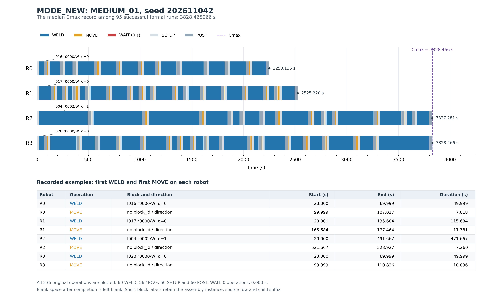

# 项目最终报告：父焊缝模式调整与方向感知联合重构

日期：2026-11-04。本文是当前阶段统一总报告，后续论文的方法、实验表格和结论以本文为主入口。[原独立实验报告](FINAL_PARENT_MODE_JOINT_RECONSTRUCTION.md)、[开发消融报告](PARENT_MODE_JOINT_RECONSTRUCTION_05.md)及[GNN终止报告](GNN_INITIAL_MINCHILD05_FINAL.md)保留为原始阶段记录，不覆盖其数据。

当前主方法为MODE_NEW，对应消融为FIXED_NEW。全部135条GNN方法结果、162次30秒开发运行、500次60秒独立正式运行已经完成。本次仅做既有数据与代码的诊断、文档整理和作图，没有重跑任何实验、B32或几何生成，没有训练模型，也没有修改正式算法。已经发现的初始化状态分类问题见[根因报告](HIGH_WORKLOAD_04_ROOT_CAUSE.md)。

## 1. 研究背景与问题定义

本项目研究船舶小组立焊接场景中双滑轨四机器人系统的焊缝任务分配、执行顺序与方向决策。上轨包含R0/R1，下轨包含R2/R3。原始父焊缝以几何起止点表示；任务模式决定将其保留为完整焊缝，或在合法切点形成两个子焊缝。每个子焊缝必须分配给有资格的机器人，并在对应路线中执行一次。

WHOLE保留整条父焊缝；Y_SPLIT根据Y覆盖带形成两个子段，既可处理无法整段覆盖的强制拆分，也可在合法目录内提供可选拆分；X_SPLIT在指定轨的有限交接位置形成左右机器人子段。模式改变既影响可分配性，也影响子段数量及前置、后置时间。分配决定每台机器人的工作集合，顺序和焊接方向共同决定定向空走及协调可行性。

目标为最小化系统最大完工时间Cmax=max(C0,C1,C2,C3)。B32负责在既有科学范围内协调四机器人操作，返回FEASIBLE状态、Cmax和操作时间线。候选构造的负载与空走代理不能代替实际调度；初始化失败也不能被解释为数学不可行。

## 2. 当前科学配置与统计符号

### 表1. 正式实验参数

|参数|当前正式配置|
|---|---|
|工作区域与机器人|20 m×12 m，双轨四机器人|
|最短子焊缝长度|min_child_length=0.50 m|
|拆分窗口|delta_x=delta_y=0.50 m|
|轨间任务覆盖带|By=[5.5,6.5] m|
|任务模式|WHOLE / Y_SPLIT / X_SPLIT|
|科学范围|FORMAL_SCOPE_V2|
|调度器|既有B32；不增加调度策略或第二套评价|
|优化目标|最小化Cmax|
|焊接/空走速度|0.0108 / 0.20 m/s|
|子段前置/后置时间|20 / 30 s|
|干涉参数|interference_dx=interference_dy=0.50 m|
|主方法/消融|MODE_NEW / FIXED_NEW|
|正式预算|60 s评价截止，包含初始化|
|正式几何与种子|20个独立几何，每个5个种子：202611041–202611045|
|方法数与运行总数|5种方法，20×5×5=500次|
|MODE_NEW/FIXED_NEW初始化与修复限制|共同参考构造2种、各Beam宽度最多4；插入位置限制8；修复局部评估上限4096；内部方向版本2|
|接受规则|仅接纳截止前完成且B32 FEASIBLE、Cmax严格改善的方案|
|认证口径|本次各方法使用原B32结果，关闭额外certify_schedule；生产默认行为保留|

配置来源为[ScientificConfig](../src/mrta_reference/model.py#L64)和正式入口显式使用的[CONFIG_05](../scripts/run_gnn_multi_initial.py#L28)。最短子段长度和拆分窗口是不同参数，不能把历史标题中的“0.50 m窗口”当作0.50 m子段约束。当前代码的窗口候选为配置边界与中心，另保留合法MIDPOINT；不额外加入历史±0.20 m内切点。

加工负载P包含SETUP（前置）、WELD和POST。本文MOVE与WAIT均为操作总时长，单位s；焊接长度单位m。方向0=start→end，方向1=end→start。REGION在表格中简写，完整方法名为REGION_FAST_ROUTE_REORDER；WAG、HGA均为现有适配版本。

历史0.20 m参数、数据、模型和结果继续保留，不进入当前正式实验表格。没有对已消费的独立测试几何重新调参。

### 数据边界

|材料|用途|本报告允许的统计单位|
|---|---|---|
|[gnn_initial_minchild05_final.csv](../results/gnn_initial_minchild05_final.csv)|135条初始构造方法结果，9几何×3种子×5方法|初始构造终止决策；Greedy与Multi4有嵌套复用|
|[parent_mode_joint_reconstruction_05.csv](../results/parent_mode_joint_reconstruction_05.csv)|162次30秒开发消融及强基线|9几何，每个方法3种子|
|[final_parent_mode_joint_reconstruction_05.csv](../results/final_parent_mode_joint_reconstruction_05.csv)|唯一500次60秒正式数据源|20几何，每个方法5种子|
|历史FINAL_COORDINATION_COMPARISON.md|历史GRC-ALNS比较|不进入本轮正式统计；其中同名HIGH_WORKLOAD_04不是本轮几何|
|已有555项软件回归测试|软件验证记录|不属于科学实验运行，不计入上述样本量|

正式CSV另有1条方法选择、1条几何选择和20条几何记录；只有record=run的500行计为运行。原始CSV和已有阶段报告在本次工作中均未改写。

## 3. 项目研究路线与当前取舍

|研究阶段|实际作用与证据|当前处理|
|---|---|---|
|早期GA/ACO等分配与排序尝试|形成早期方法比较及工程实现经验；不属于本轮五方法正式矩阵|作为历史研究保留，不引用其历史分数替代本轮结果|
|GNN初始构造与排序|现有V2/Shared模型在0.50 m合法目录上的最后一次冻结权重评价|正式淘汰；不再训练、加候选或调温度|
|GNN局部联合修复|2×2中单独检查固定/可调模式下的增量收益|固定组有微小收益，联合主线未体现稳定实质增益，不纳入MODE_NEW|
|父焊缝模式调整|在合法目录中改变被移除父的模式/切点，再联合重插|保留；开发与独立消融均有小幅收益|
|方向感知联合重构|任务归属、位置、顺序及方向在同一插入动作中决定|保留为主方法核心，不增加独立方向阶段|
|最终MODE_NEW|共同初始化、调度反馈父选择、模式调整、联合重构、B32严格Cmax接受|正式测试前确定，测试后未修改参数|

PPO、MLP、GAT、CRRR、JRRB及独立WAIT优化等已结束路线只保留历史代码/记录，本报告不重新展开，也不将它们组合进最终方法。GNN初始构造淘汰与GNN局部联合修复是两个独立判断，不能相互替代。

## 4. 最终MODE_NEW的实际流程

共同规则初始化为两个参考分配分别构造最多4个联合插入Beam候选，按交替顺序调用B32取得共同可行解。MODE_NEW与FIXED_NEW按几何/种子复用该解及方向，并等额计入初始化时间。

每轮实际轮换RANDOM、TRAVEL、LOAD选择器；LOAD/TRAVEL使用当前B32的机器人完成时间，TRAVEL还使用已有方向下的弧空走。选择4或8个父并移除其全部旧子段。MODE_NEW在交替轮次最多改变其中一个父的合法模式；其余父保持模式后一起修复。FIXED_NEW不执行模式替换。

联合修复采用既有Regret-2流程，在合法机器人、插入位置、新子段方向及紧邻子段方向之间共同选择，使用P+MOVE代理形成一个完整候选，再调用一次B32。只有实际Cmax严格改善且候选在截止前完成才接纳。不存在独立方向优化、WAIT优化、额外调度或认证阶段。

完整配置、代码映射、伪代码及含初始化失败分支的Mermaid流程图见[MODE_NEW技术说明](MODE_NEW_ALGORITHM_TECHNICAL_NOTE.md)。有界初始化失败会阻止整个搜索启动，是本方法可行率限制的重要边界，不能在方法描述中省略。

## 5. 科学实验结果

### 5.1 统计口径

成功仅指本次B32返回并在预算内取得FEASIBLE方案。成功Cmax均值、中位数只使用成功运行；失败Cmax保持空值，既不填0，也不赋惩罚值。平均运行时间按该方法全部运行计算，包括提前失败，因此不能将失败导致的较短平均时间解释为更快求解。

配对比较以几何为单位。对于几何g，先取同方法五个种子的Cmax算术平均，再计算改善率：100×(对照均值−MODE_NEW均值)/对照均值。正值表示MODE_NEW更好。仅双方五个种子均成功的几何进入正式完整配对。胜/平/负沿用原报告的1e−8个百分点比较容差；五个种子不能当作五个独立几何。开发消融相应采用三个种子。

平均和中位改善均在完整配对几何的改善率上计算，不是将不同几何、不同种子的Cmax直接混合后比较。没有新增Bootstrap、显著性检验或新的评分体系。以下仅按既有项目报告记载的口径核对、整理，不替换原始正式结果。

### 表2. 五方法总体正式结果（60 s）

|方法|可行/总次数|可行率/%|成功Cmax均值/s|成功Cmax中位/s|平均运行/s|已接受模式变化A均值|初末不同父数N均值|
|---|---|---|---|---|---|---|---|
|MODE_NEW|95/100|95.0|3588.925|3828.466|58.947|1.400|—|
|FIXED_NEW|95/100|95.0|3615.081|3864.564|58.777|0.000|—|
|WAG|100/100|100.0|3782.582|3951.994|60.701|—|0.170|
|HGA|100/100|100.0|3913.853|3953.539|60.599|—|0.140|
|REGION|100/100|100.0|3862.769|3967.361|61.147|—|1.750|

A表示已接受的单父模式/切点变化提案次数；MODE_NEW与FIXED_NEW记录此含义。N表示初始与最终模式/切点不同的父数量；WAG、HGA、REGION记录此含义。均值以各方法100次运行为分母，初始化失败行按原始记录为0。“—”表示该计数口径未在该方法的mode_changes字段中记录，不表示零。A与N分列，不能横向解释成相同的搜索模式变更次数；这保留了原始字段的真实定义，未新增统计指标。

全部500次中490次取得可行结果，另10次为同一HIGH_WORKLOAD_04的MODE_NEW/FIXED_NEW初始化失败。MODE_NEW成功样本均值较低不能单独证明总体优越，因为它缺少最困难几何之一的五个Cmax，而对照方法都有完整结果。

### 表3. MODE_NEW与对照方法的正式几何配对

|MODE_NEW相对方法|完整配对几何|胜/平/负|平均改善/%|中位改善/%|
|---|---|---|---|---|
|FIXED_NEW|19|17/0/2|0.6304|0.3422|
|WAG|19|9/0/10|2.5878|-0.1280|
|HGA|19|19/0/0|5.6042|2.3980|
|REGION|19|7/0/12|1.6577|-0.3354|

四项比较均排除HIGH_WORKLOAD_04，因此完整配对数量是19而非20。主方法95/100的可行率低于三个强对照的100/100，应与Cmax配对同时阅读。对HGA的19胜仅是完整配对的条件性Cmax结果，不代表包括失败率在内的整体支配。

### 表4a. 不同规模组的正式结果

|组别|方法|可行/总次数|可行率/%|成功Cmax均值/s|成功Cmax中位/s|平均运行/s|
|---|---|---|---|---|---|---|
|SMALL|MODE_NEW|25/25|100.0|2325.136|2211.845|60.133|
|SMALL|FIXED_NEW|25/25|100.0|2339.104|2257.701|60.103|
|SMALL|WAG|25/25|100.0|2342.445|2230.098|60.222|
|SMALL|HGA|25/25|100.0|2368.191|2250.238|60.107|
|SMALL|REGION|25/25|100.0|2548.185|2204.119|60.869|
|MEDIUM|MODE_NEW|25/25|100.0|3125.121|2880.046|60.692|
|MEDIUM|FIXED_NEW|25/25|100.0|3136.928|2936.416|60.587|
|MEDIUM|WAG|25/25|100.0|3127.178|2864.031|60.550|
|MEDIUM|HGA|25/25|100.0|3263.777|3318.741|60.322|
|MEDIUM|REGION|25/25|100.0|3114.243|2812.032|60.905|
|LARGE|MODE_NEW|25/25|100.0|4421.116|4336.750|60.608|
|LARGE|FIXED_NEW|25/25|100.0|4435.104|4345.078|60.518|
|LARGE|WAG|25/25|100.0|4803.293|4659.743|61.161|
|LARGE|HGA|25/25|100.0|4889.917|4743.148|60.888|
|LARGE|REGION|25/25|100.0|4482.816|4576.081|61.138|
|HIGH_WORKLOAD|MODE_NEW|20/25|80.0|4708.178|4684.532|54.357|
|HIGH_WORKLOAD|FIXED_NEW|20/25|80.0|4782.712|4687.816|53.901|
|HIGH_WORKLOAD|WAG|25/25|100.0|4857.414|4652.329|60.873|
|HIGH_WORKLOAD|HGA|25/25|100.0|5133.528|4783.816|61.078|
|HIGH_WORKLOAD|REGION|25/25|100.0|5305.832|4654.218|61.676|

每组各5个静态几何、每方法25次运行。组别由生成前的静态规则决定；SMALL实际35条，MEDIUM为54–57条，LARGE为63–85条，HIGH_WORKLOAD为65–92条父焊缝，不能把组名当成精确父数量。没有事后裁剪、补段或换几何。

### 表4b. 不同规模组的几何配对

|组别|MODE_NEW相对方法|配对几何|胜/平/负|平均改善/%|中位改善/%|
|---|---|---|---|---|---|
|SMALL|FIXED_NEW|5|4/0/1|0.5093|0.5143|
|SMALL|WAG|5|4/0/1|0.7124|0.6904|
|SMALL|HGA|5|5/0/0|1.7914|1.6472|
|SMALL|REGION|5|2/0/3|5.7989|-0.2397|
|MEDIUM|FIXED_NEW|5|4/0/1|0.3627|0.3422|
|MEDIUM|WAG|5|2/0/3|0.0300|-0.1280|
|MEDIUM|HGA|5|5/0/0|4.2422|2.7465|
|MEDIUM|REGION|5|3/0/2|-0.3585|0.0739|
|LARGE|FIXED_NEW|5|5/0/0|0.3212|0.2168|
|LARGE|WAG|5|1/0/4|6.1591|-0.3213|
|LARGE|HGA|5|5/0/0|7.8904|2.3980|
|LARGE|REGION|5|1/0/4|0.9781|-2.5120|
|HIGH_WORKLOAD|FIXED_NEW|4|4/0/0|1.5031|1.1378|
|HIGH_WORKLOAD|WAG|4|2/0/2|3.6653|0.7029|
|HIGH_WORKLOAD|HGA|4|4/0/0|9.2147|8.8410|
|HIGH_WORKLOAD|REGION|4|1/0/3|-0.1492|-0.9029|

HIGH_WORKLOAD只剩4个完整配对：HIGH_WORKLOAD_01、02对WAG有改善，03落后0.6317%、05落后0.3717%；HIGH_WORKLOAD_04另有全部五种子的主方法初始化失败。因此即使这四个成功几何的中位改善为+0.7029%，也不能说整个高工作量组全面优于WAG。对REGION，高工作量完整配对为1胜3负，中位−0.9029%。

### 表5a. 父模式消融的开发与独立证据

|数据集/预算|可行次数MODE/FIXED|完整配对几何|胜/平/负|平均改善/%|中位改善/%|
|---|---|---|---|---|---|
|开发消融/30 s|27/27；27/27|9|5/1/3|2.15937|0.51696|
|独立正式/60 s|95/100；95/100|19|17/0/2|0.63044|0.34220|

这是两套不同用途的数据，不能合并样本量。两套结果均支持小幅模式收益，独立中位改善0.3422%也说明收益有限。

### 表5b. 完整2×2开发矩阵及强基线（9几何×3种子×6方法）

|开发方法（30 s）|可行/次数|成功Cmax均值/s|成功Cmax中位/s|平均运行/s|
|---|---|---|---|---|
|FIXED_NEW|27/27|3252.353|3341.549|30.770|
|FIXED_GNN|27/27|3215.921|3324.842|30.790|
|MODE_NEW|27/27|3197.466|3341.549|30.761|
|MODE_GNN|27/27|3194.114|3341.549|30.853|
|WAG|27/27|3411.290|3352.865|30.447|
|HGA|27/27|3586.393|3369.182|30.650|

### 表5c. 开发几何配对与最终选择

|开发配对比较|配对几何|胜/平/负|平均改善/%|中位改善/%|
|---|---|---|---|---|
|MODE_NEW vs FIXED_NEW|9|5/1/3|2.15937|0.51696|
|MODE_GNN vs FIXED_GNN|9|3/1/5|0.95015|-0.03017|
|MODE_GNN vs MODE_NEW|9|5/1/3|0.10327|0.00144|
|FIXED_GNN vs FIXED_NEW|9|6/2/1|1.31894|0.09645|
|MODE_NEW vs WAG|9|8/0/1|6.22126|0.66494|
|MODE_NEW vs HGA|9|8/0/1|10.57056|8.00689|

MODE_GNN对MODE_NEW的中位增益只有0.00144%；其自身MODE对FIXED为3胜1平5负，中位−0.03017%。FIXED_GNN对FIXED_NEW虽有0.09645%的中位收益，仍不足以把GNN解释为有效联合主线中的稳定增益来源。最终在生成独立几何之前选择MODE_NEW，同时考虑所选路线自身的模式消融；未根据正式测试结果重新选算法或调参。

### 表6. GNN初始构造终止实验（135条方法结果）

|初始构造方法|可行/次数|可行率/%|成功Cmax均值/s|成功Cmax中位/s|
|---|---|---|---|---|
|RULE/BEAM|27/27|100.00|3448.686|3399.247|
|GNN-V2-Greedy|0/27|0.00|—|—|
|GNN-V2-Multi4|0/27|0.00|—|—|
|GNN-Shared-Greedy|6/27|22.22|6840.550|6840.550|
|GNN-Shared-Multi4|6/27|22.22|6840.550|6840.550|

九个几何、三个种子、五种方法，共135条结果。Greedy复用Multi4第一候选，不能把135条统计行当作135次独立采样过程或把嵌套B32次数直接相加。所有方法固定父模式、相同0.50 m目录和B32；RULE/BEAM最多4次完整评价，Multi4为Greedy加既有三个采样，不补采、不改温度。

两种Multi4均不满足“可行率不低于RULE/BEAM、至少5个几何优于RULE、几何中位改善至少0.5%、覆盖至少两个规模”的原停止条件。故正式停止GNN初始分配与排序。已有V2训练轨迹294条中30条、Shared轨迹40条中4条含短于0.50 m的子段，最短约0.277058 m；该实验是冻结既有模型迁移到0.50 m目录的评价，不能写成针对0.50 m域新训练模型的实验。

### 表7. 当前HIGH_WORKLOAD_04可行性

|方法|可行/次数|可行率/%|成功Cmax均值/s|失败或成功阶段|
|---|---|---|---|---|
|MODE_NEW|0/5|0.0|—|共同初始化失败，搜索未启动|
|FIXED_NEW|0/5|0.0|—|共同初始化失败，搜索未启动|
|WAG|5/5|100.0|4610.342|已取得B32可行初始/最终方案|
|HGA|5/5|100.0|4778.338|已取得B32可行初始/最终方案|
|REGION|5/5|100.0|7696.989|已取得B32可行初始/最终方案|

该实例的几何种子为2026110512、92条父焊缝、总长135.222517 m、1个强制拆分父。它与历史GRC-ALNS报告中的同名实例不同。MODE_NEW/FIXED_NEW按种子共享5组初始化，各8次完整B32评价，物理上共40次共同候选调用；两方法行中的重复计次是共同初解成本的等额计入。

现有失败行未保存候选和阻塞轨迹，最多能确认有限初始化未获得可行入口。未达到60秒即提前退出是现有控制流；原始TIME_LIMIT_NO_FEASIBLE在此混合了初始化失败与时间截止的标签，不能据标签认定超时。最小修复建议仅涉及原因标签，当前未修改代码或原始记录，也未重跑实例。更具体的任务顺序、方向或死锁原因仍未识别，详见[根因分析](HIGH_WORKLOAD_04_ROOT_CAUSE.md)。

## 6. 典型真实调度时间线

从95条MODE_NEW成功正式记录中计算Cmax中位数，再按与中位数的绝对差最小选择；若并列，按实例名称和种子排序。选中**MEDIUM_01、seed=202611042**，CSV行56，Cmax=3828.465966161135 s，恰好等于成功记录中位数。该例来自500次正式实验，不来自30秒开发集，也不是最好案例。

图中横轴为秒、纵轴为R0–R3。按原始t0/t1绘制236条操作：60个WELD、56个MOVE、60个SETUP、60个POST。**原始记录没有WAIT操作，WAIT总时长为0**，故图中只保留WAIT颜色说明，不人为增加等待段。每台机器人完工后的空白保持为空，没有估算或填补时间段。图中SETUP/POST与纯WELD分开，防止把整个加工负载误标成纯焊接时间。

### 表8. 典型正式运行的任务分配与完成时间

|机器人|子段数|长度/m|加工P/s|MOVE/s|WAIT/s|完成/s|
|---|---|---|---|---|---|---|
|R0|12|17.067341|2180.309|69.826|0.000|2250.135|
|R1|16|17.156107|2388.528|136.691|0.000|2525.220|
|R2|14|32.807709|3737.751|89.530|0.000|3827.281|
|R3|18|30.191856|3695.542|132.924|0.000|3828.466|

该解包含50个WHOLE父、4个Y_SPLIT父和1个X_SPLIT父，合计60个子段。上轨两台机器人较早完成，下轨R2/R3接近同时完成；Cmax由R3决定。R2加工负载比R3高42.209秒，但R3空走比R2多43.394秒，因此R3反而晚1.185秒结束。即使本例WAIT为0，也能看出仅比较加工负载不足以判断最终Cmax。

图中代表性子段沿用原始inst编号、源row和子段后缀作紧凑显示；W表示whole，0/1为拆分子段后缀，d为方向位。完整编号及首个WELD的实际时间如下：

- R0首个WELD：`inst0016|group=804-FR315A|row=0000::whole`，方向0，20.000000–69.999180 s，持续49.999180 s。
- R1首个WELD：`inst0017|group=804-FR314A|row=0000::whole`，方向0，20.000000–135.683893 s，持续115.683893 s。
- R2首个WELD：`inst0004|group=804-TB310A.dxf|row=0002::whole`，方向1，20.000000–491.666667 s，持续471.666667 s。
- R3首个WELD：`inst0020|group=804-FR315A|row=0000::whole`，方向0，20.000000–69.999180 s，持续49.999180 s。

MOVE操作没有block_id或焊接方向字段时，图中明确标为未记录，不人为继承相邻焊缝的方向。图下表列出各机器人首个WELD和首个MOVE的开始、结束及持续时间；完整236条操作仍在唯一正式CSV的payload.details.final_state.operations中。

## 7. 项目最终结论与论文可用主张

1. 父模式调整在相同共同初解和联合修复下有小幅、可重复的消融收益，独立完整配对17胜2负，中位改善0.3422%，平均0.6304%。
2. MODE_NEW相对HGA的完整配对Cmax较好，但95%可行率低于HGA的100%，论文必须保留这一限制。
3. MODE_NEW未稳定优于WAG：几何9胜10负、中位改善−0.1280%。平均改善为正不能代替中位数和胜负结论。
4. MODE_NEW未稳定优于REGION：7胜12负、中位−0.3354%；LARGE中位落后2.5120%，HIGH_WORKLOAD的完整配对中位落后0.9029%。
5. HIGH_WORKLOAD_04暴露了共同有界初始化的可靠性不足。两个联合修复方法同时失败说明它发生在共同入口，不能归因于MODE_NEW的模式调整搜索，也不能解释为任务不可行。
6. GNN初始构造停止；GNN局部联合修复不纳入最终主线。最终算法维持MODE_NEW，没有在正式测试后叠加其他历史模块或调整参数。

当前实验材料已具备撰写方法、实验、消融与局限章节的条件。可用的主张是父模式与方向感知联合重构具有有限的增量价值和有条件的Cmax竞争力；现有证据不支持全面优于所有强基线或具有更高可行率的主张。独立集已经消费，下一步为论文写作，不继续算法扩展或正式集调参。

## 8. 软件验证与本次整理核对

此前完整回归记录为**555 passed in 74.97 s**，这是软件验证，不是555次科学试验。本次只新增三份Markdown材料和一张真实时间线PNG、局部修正README，没有修改分析脚本或正式算法，也没有重跑整套555项测试。

本次针对性核对包括：按record字段区分500条运行与元数据；核对方法/几何/种子分组；按原有公式核对均值、中位数与几何配对表；检查10条失败Cmax仍为空；确认中位记录选择、236条原始操作及WAIT=0；检查PNG可打开并人工查看布局。未调用任何项目调度或生成函数，未新建评价、日志、认证、哈希或运行身份框架。

